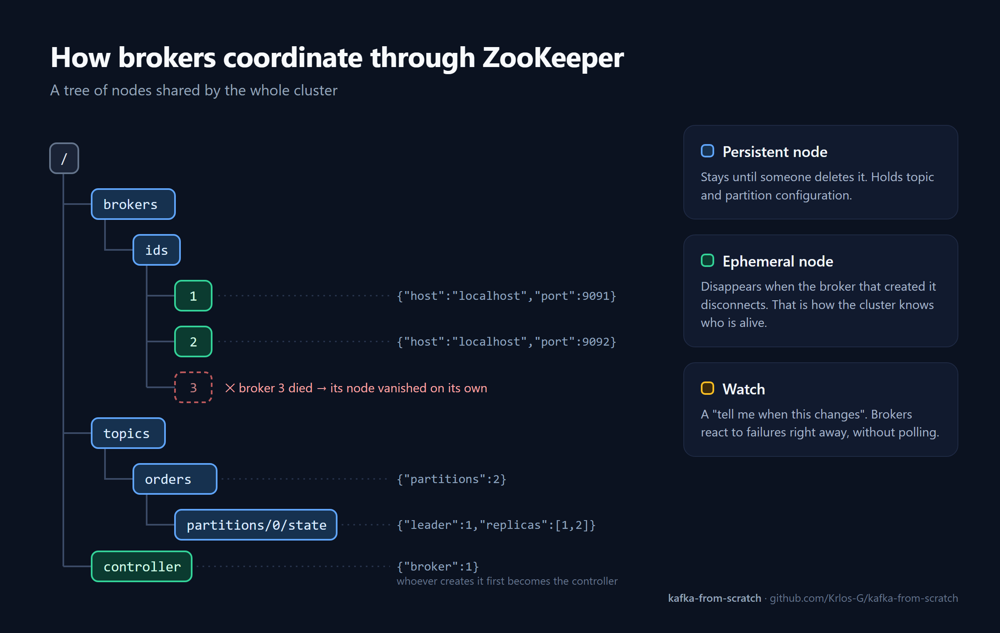

# kafka-from-scratch

🇧🇷 [Leia em português](README.pt-BR.md)

A messaging system inspired by [Apache Kafka](https://kafka.apache.org/), written from scratch in Java to understand how Kafka works under the hood: binary protocol, cluster coordination, log-based storage and replication.

> 🚧 **Work in progress:** stages 1–4 of 8 completed.

This project follows the series [Building Your Own Kafka-like System From Scratch](https://buildthingsuseful.medium.com/building-your-own-kafka-like-system-from-scratch-a-step-by-step-guide-d3c5f0a303c0) by Raghav. Most of the articles describe the idea behind each component without the full code, so many formats and implementation details were designed by me (see [Implementation decisions](#implementation-decisions)).

## Progress

| Stage | Component | Status |
|---|---|---|
| 1 | Project structure (Maven) | ✅ |
| 2 | Binary protocol (`Protocol`, `BrokerInfo`) | ✅ |
| 3 | ZooKeeper integration (`ZookeeperClient`) | ✅ |
| 4 | Storage layer (`Partition`) | ✅ |
| 5 | Broker | ⏳ |
| 6 | Client library | ⏳ |
| 7 | Producer and consumer APIs | ⏳ |
| 8 | Tests | ⏳ |

## What's implemented

### Binary protocol: `Protocol`

Clients and brokers talk through a custom binary protocol built on `ByteBuffer`. Every message starts with **1 type byte**, followed by its fields in a fixed layout. Strings and arrays are always length-prefixed.

| Type | Code | Layout |
|---|---|---|
| `PRODUCE` | `0x01` | `[type][topic][4 partition][4 msg len][msg]` |
| `FETCH` | `0x02` | `[type][topic][4 partition][8 offset][4 maxBytes]` |
| `METADATA` | `0x03` | `[type]` |
| `CREATE_TOPIC` | `0x04` | `[type][topic][4 partitions][2 replication factor]` |
| `REPLICATE` | `0x05` | `[type][topic][4 partition][8 offset][4 msg len][msg]` |
| `TOPIC_NOTIFICATION` | `0x06` | `[type][topic]` |
| `PRODUCE_RESPONSE` | `0x11` | `[type][8 offset]` |
| `FETCH_RESPONSE` | `0x12` | `[type][4 count]` + per message: `[8 offset][4 len][msg]` |
| `METADATA_RESPONSE` | `0x13` | `[type]` + brokers + topics → partitions → replicas |
| `ERROR_RESPONSE` | `0x14` | `[type][error message]` |

`[topic]` and other strings = `[2-byte length][N UTF-8 bytes]`. Numbers are big-endian.

### Coordination: `ZookeeperClient`

A wrapper around the official ZooKeeper client that handles:

- **Connection and session:** waits for the connection with a `CountDownLatch` and reconnects if the session expires
- **Persistent nodes:** topic and partition configuration (`/topics/...`)
- **Ephemeral nodes:** registration of live brokers (`/brokers/ids/<id>`). If a broker dies, its node disappears on its own
- **Watches:** callbacks for changes to a node or its children, re-registered on every trigger, since ZooKeeper watches only fire once



### Storage: `Partition`

Each partition is an **append-only log** split into **segments** of up to 1 MB. Each segment is a pair of files named after the first offset it contains:

```
data/orders-0/
├── 00000000000000000000.log      ← messages: [4-byte length][message]...
├── 00000000000000000000.index    ← 16-byte entries: [8 offset][8 position in .log]
├── 00000000000000001523.log
└── 00000000000000001523.index
```

- **`append`:** writes to the end of the active segment, calls `force(true)` for durability and records the position in the index. Rolls over to a new segment when the current one is full
- **`readMessages(offset, maxBytes)`:** finds the right segment, uses the index to jump straight to the message and reads sequentially, crossing segment boundaries if needed
- **Recovery:** on startup, loads existing segments and computes the next offset from the last index. Data survives restarts
- **Concurrency:** a `ReadWriteLock` allows concurrent reads and one write at a time

## Implementation decisions

Places where this project differs from the articles or fills in what they don't show:

- **Protocol layouts:** the articles only give method signatures. The byte formats in the table above, especially the responses, were designed here.
- **Dense index instead of sparse:** the article mentions a sparse index, but describes lookups that compute the position directly from the offset (`relative offset × 16`), which only works with one entry per message. I went with a dense index, which also allows recovering the next offset from the `.index` file size alone.
- **Fixes to the Stage 3 article code:**
  - the article's `connect()` created `/controller` as a persistent node, which broke controller election (it relies on creating that same node as ephemeral)
  - the article's `watchNode` never re-registered the watch, so it only detected the first change
  - parent paths (e.g. `/brokers/ids`) are now created recursively

## Running

**Requirements:** Java 21, Maven and Docker (for ZooKeeper).

```bash
# ZooKeeper
docker run -d --name zookeeper -p 2181:2181 zookeeper:3.8

# build
mvn compile
```

For now, `Main` is a scratchpad for manually testing the components. The runnable broker arrives in Stage 5.

## Structure

```
src/main/java/com/simplekafka/
└── broker/
    ├── BrokerInfo.java        # broker data (id, host, port)
    ├── Protocol.java          # binary protocol encode/decode
    ├── ZookeeperClient.java   # coordination via ZooKeeper
    └── Partition.java         # segmented on-disk log
```
