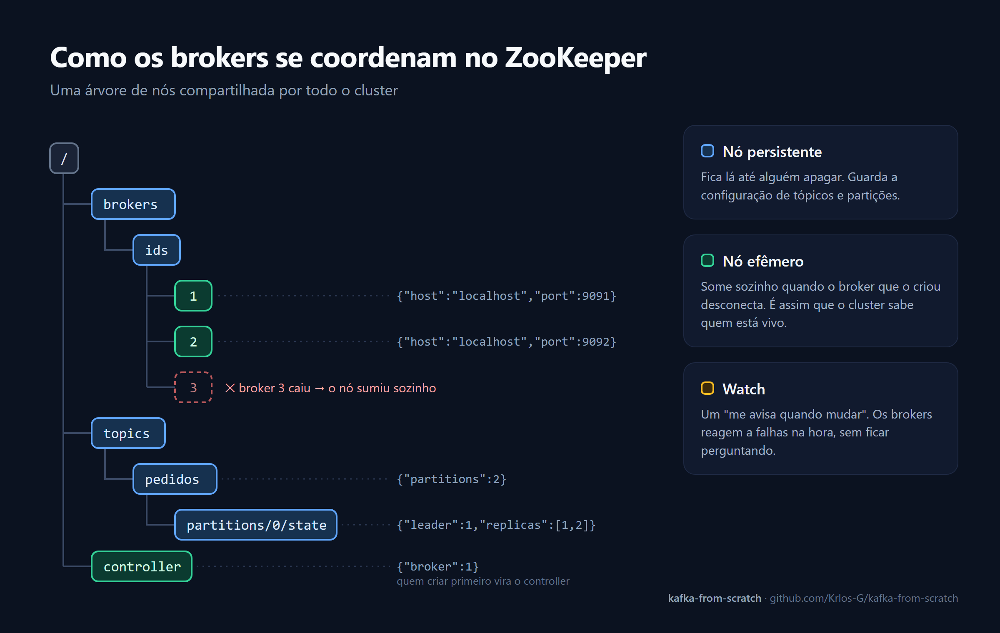

# kafka-from-scratch

🇺🇸 [Read in English](README.md)

Um sistema de mensageria inspirado no [Apache Kafka](https://kafka.apache.org/), escrito do zero em Java para entender por dentro como o Kafka funciona: protocolo binário, coordenação de cluster, armazenamento em log e replicação.

> 🚧 **Em construção:** Stages 1–4 de 8 concluídos.

O projeto segue a série [Building Your Own Kafka-like System From Scratch](https://buildthingsuseful.medium.com/building-your-own-kafka-like-system-from-scratch-a-step-by-step-guide-d3c5f0a303c0), de Raghav. Grande parte dos artigos descreve só a ideia de cada componente, sem o código completo, então vários formatos e detalhes de implementação foram desenhados por mim (veja [Decisões de implementação](#decisões-de-implementação)).

## Progresso

| Stage | Componente | Status |
|---|---|---|
| 1 | Estrutura do projeto (Maven) | ✅ |
| 2 | Protocolo binário (`Protocol`, `BrokerInfo`) | ✅ |
| 3 | Integração com ZooKeeper (`ZookeeperClient`) | ✅ |
| 4 | Camada de storage (`Partition`) | ✅ |
| 5 | Broker | ⏳ |
| 6 | Biblioteca cliente | ⏳ |
| 7 | APIs de producer e consumer | ⏳ |
| 8 | Testes | ⏳ |

## O que já está implementado

### Protocolo binário: `Protocol`

Clientes e brokers conversam por um protocolo binário próprio, usando `ByteBuffer`. Toda mensagem começa com **1 byte de tipo**, seguido dos campos num layout fixo. Strings e arrays vão sempre com o tamanho antes (*length-prefixed*).

| Tipo | Código | Layout |
|---|---|---|
| `PRODUCE` | `0x01` | `[tipo][tópico][4 partição][4 tam. msg][msg]` |
| `FETCH` | `0x02` | `[tipo][tópico][4 partição][8 offset][4 maxBytes]` |
| `METADATA` | `0x03` | `[tipo]` |
| `CREATE_TOPIC` | `0x04` | `[tipo][tópico][4 nº partições][2 fator de replicação]` |
| `REPLICATE` | `0x05` | `[tipo][tópico][4 partição][8 offset][4 tam. msg][msg]` |
| `TOPIC_NOTIFICATION` | `0x06` | `[tipo][tópico]` |
| `PRODUCE_RESPONSE` | `0x11` | `[tipo][8 offset]` |
| `FETCH_RESPONSE` | `0x12` | `[tipo][4 qtd.]` + por mensagem: `[8 offset][4 tam.][msg]` |
| `METADATA_RESPONSE` | `0x13` | `[tipo]` + brokers + tópicos → partições → réplicas |
| `ERROR_RESPONSE` | `0x14` | `[tipo][mensagem de erro]` |

`[tópico]` e outras strings = `[2 bytes tamanho][N bytes UTF-8]`. Números em big-endian.

### Coordenação: `ZookeeperClient`

Um wrapper sobre o cliente oficial do ZooKeeper, que cuida de:

- **Conexão e sessão:** usa um `CountDownLatch` para esperar a conexão e reconecta se a sessão expirar
- **Nós persistentes:** configuração de tópicos e partições (`/topics/...`)
- **Nós efêmeros:** registro dos brokers vivos (`/brokers/ids/<id>`). Se um broker cai, o nó some sozinho
- **Watches:** callbacks para mudanças em nós e nos filhos de um nó, registrados de novo a cada disparo, porque watches do ZooKeeper disparam uma vez só



### Armazenamento: `Partition`

Cada partição é um **log append-only** dividido em **segmentos** de até 1 MB. Cada segmento tem um par de arquivos com o nome do primeiro offset que ele contém:

```
data/pedidos-0/
├── 00000000000000000000.log      ← mensagens: [4 bytes tamanho][mensagem]...
├── 00000000000000000000.index    ← entradas de 16 bytes: [8 offset][8 posição no .log]
├── 00000000000000001523.log
└── 00000000000000001523.index
```

- **`append`:** grava no fim do segmento ativo, faz `force(true)` para garantir durabilidade e registra a posição no índice. Cria um segmento novo quando o atual enche
- **`readMessages(offset, maxBytes)`:** acha o segmento certo, usa o índice para pular direto à posição da mensagem e lê em sequência, atravessando segmentos se precisar
- **Recuperação:** ao iniciar, carrega os segmentos existentes e calcula o próximo offset a partir do último índice. Os dados sobrevivem a reinícios
- **Concorrência:** `ReadWriteLock`, que permite várias leituras simultâneas e uma escrita por vez

## Decisões de implementação

Pontos em que este projeto difere dos artigos ou completa o que eles não mostram:

- **Layouts do protocolo:** os artigos dão só as assinaturas dos métodos. Os formatos de bytes da tabela acima, principalmente os das respostas, foram definidos aqui.
- **Índice denso em vez de esparso:** o artigo fala em índice esparso, mas descreve a busca calculando a posição direto pelo offset (`offset relativo × 16`), o que só funciona com uma entrada por mensagem. Optei pelo índice denso, que também permite recuperar o próximo offset só pelo tamanho do `.index`.
- **Correções em relação ao artigo do Stage 3:**
  - o `connect()` do artigo criava `/controller` como nó persistente, o que impedia a eleição de controller (que depende de criar esse mesmo nó como efêmero)
  - o `watchNode` do artigo não registrava o watch de novo, então só detectava a primeira mudança
  - os caminhos pai (ex.: `/brokers/ids`) agora são criados recursivamente

## Como rodar

**Requisitos:** Java 21, Maven e Docker (para o ZooKeeper).

```bash
# ZooKeeper
docker run -d --name zookeeper -p 2181:2181 zookeeper:3.8

# compilar
mvn compile
```

Por enquanto, o `Main` serve de área de testes manuais dos componentes. O broker executável chega no Stage 5.

## Estrutura

```
src/main/java/com/simplekafka/
└── broker/
    ├── BrokerInfo.java        # dados de um broker (id, host, porta)
    ├── Protocol.java          # encode/decode do protocolo binário
    ├── ZookeeperClient.java   # coordenação via ZooKeeper
    └── Partition.java         # log segmentado em disco
```
